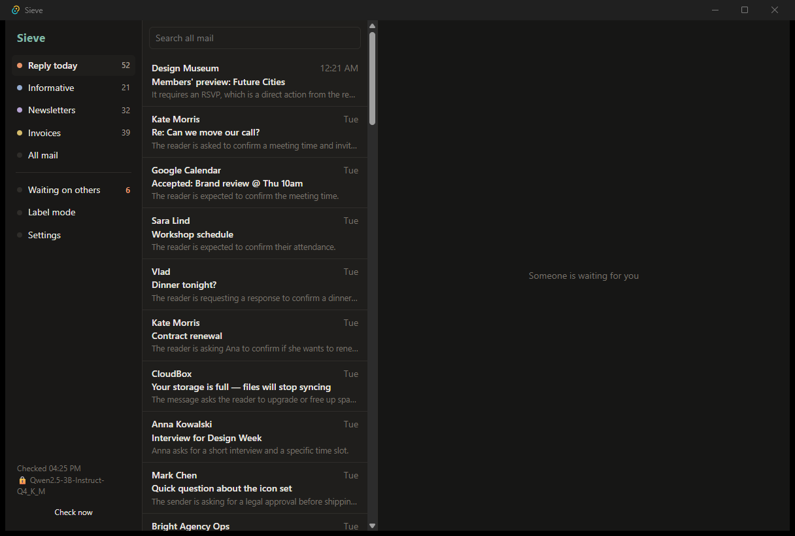
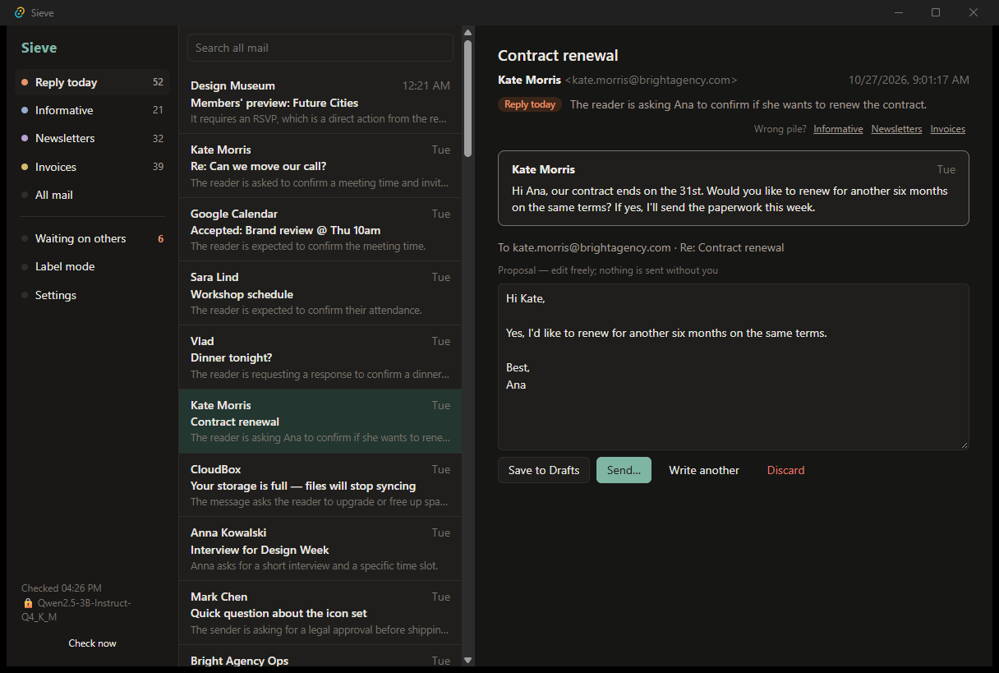
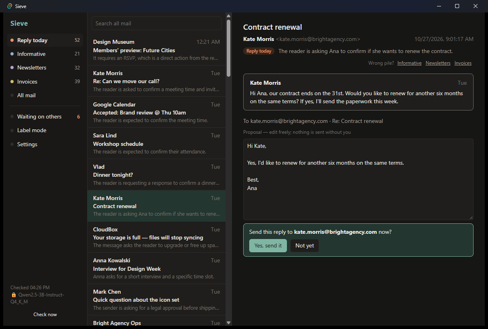

# Sieve

Inbox triage that runs on your computer. A background service syncs your mail over IMAP and sorts
every message into one of four piles: **reply today**, **informative**, **newsletter**, **invoice**.
It also:

- summarizes long threads;
- drafts replies in your style, learned from the mail you sent;
- reminds you when someone has not answered you.

A local language model (llama.cpp) does the reading, so your mail never leaves the machine. Nothing
is sent unless you confirm it.

| Inbox | A draft in your style | Sending needs your confirmation |
|---|---|---|
|  |  |  |

## How it works

```
IMAP server ──► sieved (Rust, runs in the background) ──────────────────────► SQLite + FTS5 index
                 │ every minute: fetch new UIDs (BODY.PEEK: nothing is marked read)
                 │ triage each new message ─────────► llama-server on 127.0.0.1
                 │ summarize threads of 4+ messages        (JSON-schema answers)
                 │ sent mail that asks something → follow-up, closed when someone answers
                 └─ local API on 127.0.0.1:7878 (token) ◄── Sieve app (Tauri + Svelte/TypeScript)
                                                             └─ Send → confirmation → SMTP, copy to Sent
```

| Part | Language | Where |
|---|---|---|
| Daemon: IMAP sync, index, triage, summaries, drafts, follow-ups, local API | Rust | [core/](core/) |
| Evaluation harness, prompt and model experiments | Python | [eval/](eval/) |
| Desktop app | TypeScript (Svelte) on Tauri 2 | [app/](app/) |

### Triage

The model reads the sender, the recipients, the subject and the first 1,500 characters of the text.
It also gets a few facts taken from the headers:
- the message has a `List-Unsubscribe` header, or its text offers a way to unsubscribe;
- the sender address looks automated;
- names of attachments;
- the reader is only in Cc, or not among the recipients at all;
- the sender is from the reader's own organization.

The model answers in a JSON schema: a short reason, then one of the four categories. The prompt is
[core/sieve-core/prompts/triage.txt](core/sieve-core/prompts/triage.txt) and follows the labelling
guide [bench/LABELING.md](bench/LABELING.md).

### Drafts

A draft answers the message and the thread before it. Three of your past messages most like this
reply go into the prompt as examples, found by BM25 over your sent mail and preferring the same
recipient. The draft goes to the server's Drafts folder when you click Save, or out by SMTP when you
click Send and confirm.

The daemon refuses to send unless the request carries a confirmation string made of exactly that
draft's id and recipients. The API test checks this. No other code path sends mail.

### Follow-ups

A cheap first pass, a regular expression for questions and requests in Romanian and English, picks
the sent messages worth asking the model about. The model then decides whether you are now waiting
for an answer, from whom, and for what. A follow-up is due after 3 working days and closes by itself
when someone answers in the thread.

### Privacy

- The model runs in a llama.cpp server bound to 127.0.0.1.
- The local API also listens only on 127.0.0.1 and requires a fresh random token, written to your
  data folder at every start.
- Passwords live in Windows Credential Manager (or the platform's keyring), never in a file.
- The connection to the mail server must use TLS. An unencrypted connection is allowed only to a
  server on this computer.

## Results

Every number comes from `eval/` and is saved in [eval/results/](eval/results/). The model ran on an
RTX 2060 laptop GPU.

### The labelled set

The set has 290 messages:
- **120 written for this evaluation** ([bench/triage_written.jsonl](bench/triage_written.jsonl)): the
  inbox of Ana Popescu, a fictional designer in Cluj. 60 are in Romanian and 60 in English, 15 per
  language and pile, with the hard cases from the guide: a client disputing an invoice, a newsletter
  that says "reply now", confirmations, mail where Ana is only in Cc.
- **170 real messages from the Enron corpus** (2000–2002), drawn from inboxes, plus extra candidates
  for newsletters and money. Only their ids and labels are in this repository
  ([bench/enron_triage_labels.json](bench/enron_triage_labels.json)). `python -m sieve_eval.enron
  build` rebuilds the texts from the published corpus, using a pinned shard checked by SHA-256.

The labels are by the project's author, following [bench/LABELING.md](bench/LABELING.md). The set
has 58 reply_today, 121 informative, 76 newsletter and 35 invoice messages.

**Dev/test split.** Before any prompt work, the messages were split by a hash of their id into dev
(128) and test (162). All prompt changes were tried on dev only. The table reports test.

### Triage, test set (162 messages)

| System | Accuracy (95% CI) | Macro-F1 (95% CI) | Romanian | English (written) | Enron | reply_today recall | Time per message |
|---|---|---|---|---|---|---|---|
| Majority class (informative) | 0.38 (0.31–0.46) | 0.14 | 0.23 | 0.23 | 0.50 | 0.00 | – |
| Header and keyword rules | 0.69 (0.62–0.76) | 0.69 | 0.87 | 0.85 | 0.57 | 0.43 | – |
| TF-IDF + logistic regression (5-fold cross-validation) | 0.71 (0.64–0.77) | 0.69 | 0.67 | 0.65 | **0.75** | 0.27 | – |
| Qwen2.5-3B-Instruct Q4_K_M | 0.75 (0.69–0.81) | 0.76 (0.68–0.81) | 0.87 | 0.88 | 0.66 | **0.84** | 0.5 s |
| **Qwen2.5-7B-Instruct Q4_K_M** | **0.86 (0.81–0.91)** | **0.88 (0.83–0.92)** | **0.97** | **0.97** | **0.78** | **0.84** | 0.7 s |

The 95% intervals are bootstrapped over messages. "Romanian" and "English (written)" are the
hand-written messages; "Enron" is the real ones.

What the numbers say:

- **The point of the model is reply_today.** Rules and TF-IDF find a third to two fifths of the
  messages that need an answer. Both models find 84%.
- **The 7B model is clearly better.** With 4.7 GB it fits a 6 GB GPU and takes 0.7 s per message. The
  3B model's typical mistake is calling a colleague's group mail (a report, a forwarded article, an
  announcement) a newsletter or a request: its informative recall is 0.50, against 0.90 for 7B.
- **Real mail is harder than written mail.** On Enron, TF-IDF trained on the same kind of messages is
  close to 7B and ahead of 3B. Corporate group mail is the ambiguous case.

**Prompt experiments**, with the 3B model on dev, each change kept only if dev improved:

| Prompt | Dev accuracy |
|---|---|
| v1: category definitions only | 0.61 |
| v2: "does THIS reader have to act?", group mail from colleagues is informative, optional replies ("if you have questions") do not count | 0.67 |
| v3: + "mail from the reader's own organization is never newsletter", with header facts on the sender's domain and on unsubscribe text | **0.69** |
| v3 with the category before the reason | 0.69 |

On the test set, the three ways of asking — reason first (shipped), category first, and no header
facts at all — score 0.75–0.76, within each other's error. The header facts matter on Romanian
(0.87 with them, 0.77 without) and cost on Enron (0.66 against 0.71).

On your own mail, the app's **Label mode** (keys 1–4) records your labels. `python -m sieve_eval.triage
mine --model M.gguf` measures the triage on them. Your mail and the result stay in `eval/work/`,
outside git.

### Follow-ups (84 sent messages: 24 of Ana's, 60 from Enron)

| Model | Precision | Recall | F1 | Ana's / Enron F1 |
|---|---|---|---|---|
| Qwen2.5-3B, regex screen then model | 0.70 | 0.72 | 0.71 | 0.91 / 0.63 |
| Qwen2.5-7B, regex screen then model | **0.81** | 0.72 | 0.76 | **1.00** / 0.64 |
| Qwen2.5-7B, model on every message | 0.80 | **0.78** | **0.79** | 1.00 / 0.68 |

The regex screen spares the model 31 of the 84 messages. It loses 2 of the 48 that expect an
answer: sent mail where the request has neither a question mark nor a request phrase.

### Summaries (6 threads of 4–6 messages, 3 Romanian, 3 English)

| Model | Key facts kept | Summaries with a number not in the thread | In the thread's language |
|---|---|---|---|
| Qwen2.5-3B | 65% (14/20) | 0 | 6/6 |
| Qwen2.5-7B | **95%** (19/20) | 1* | 6/6 |

\*The 7B summary wrote "2 nopți" for "două nopți": the check counts digits only, so a correct number
written in words counts as invented. The 3B model also misstated a decision in the demo mailbox: it
called an offer "approved" before the vote. Read its summaries as pointers, not minutes.

### Drafts in your style (Qwen2.5-3B)

Each draft is compared with the real reply its owner sent:
- **Ana:** 15 replies, 7 Romanian and 8 English.
- **Enron:** 40 replies by one employee, Chris Germany, learned from his 3,194 other sent messages.

Every copy of the real reply is kept out of the examples and the style.

| Condition | chrF, Ana | chrF, Enron | Same greeting word (Ana) | Same last line (Ana) |
|---|---|---|---|---|
| No style | 30.8 | 19.5 | 0.40 | 0.40 |
| A description of the style (greetings, sign-off, diacritics) | 37.8 | 21.4 | 0.53 | 0.87 |
| **3 most similar past messages** (shipped) | **39.6** | **22.7** | **0.87** | **0.87** |
| Description + 3 examples | 37.3 | 19.9 | 0.60 | 0.93 |

chrF is the character n-gram F-score (0–100) against the real reply. Short emails rarely share many
characters with the real one even when they say the same thing, so read the scores as comparisons
between conditions.

Two problems the evaluation found in the first version, both fixed:
- a length target ("keep it about as short as usual") made the 3B model write replies at half their
  real length;
- the learned sign-offs had picked up other people's names from forwarded text.

These conditions were compared on the same 55 replies they are reported on: there was no separate
dev set for drafts.

### End to end

`scripts/test-server.sh` runs GreenMail, a local IMAP/SMTP server; `python -m sieve_eval.demo` fills
it with Ana's mailbox. One round of the daemon on that mailbox:
- 175 messages synced and grouped into threads;
- 144 triaged in 90 s (on battery, with the GPU at a quarter of its speed);
- 6 follow-ups opened. The two people who had already answered got none.

In the app, the draft for "Contract renewal" came out as "Hi Kate, Yes, I'd like to renew for
another six months on the same terms. Best, Ana". After the confirmation it reached Kate's mailbox
on the test server, threaded under her message, with a copy in Ana's Sent folder.

## Tests

| What | Where |
|---|---|
| Parsing (headers, quoted replies, forwards, subjects), language, store, triage prompt, style learning (per language, other people's names left out), follow-up screen, working days | `cargo test -p sieve-core` (unit tests) |
| The whole IMAP path against GreenMail: fill a mailbox, sync twice, threads, triage, follow-ups, a draft to Drafts, wrong confirmations refused, confirmed send, arrival and threading | [core/sieve-core/tests/imap.rs](core/sieve-core/tests/imap.rs) |
| The local API: the token, the inbox, labels, a draft, sending refused without the exact confirmation, no password in any answer | [core/sieved/tests/api.rs](core/sieved/tests/api.rs) |
| The harness: measures, chrF, baselines, the split, the bench files' consistency, the demo mailbox | [eval/tests/test_eval.py](eval/tests/test_eval.py) |
| The interface type-checks | `npm run check` in `app/` |

CI ([.github/workflows/ci.yml](.github/workflows/ci.yml)) runs:
- all of the above on Linux and Windows, with GreenMail started in the job;
- the release build of the daemon;
- the Tauri app build.

The evaluations need a GGUF model and the Enron shard, so they run locally.

## Using it

Requirements:
- Rust (stable);
- Node 24;
- Python 3.14 for the evaluation;
- Java 21 for the test mail server;
- on Linux, `libdbus-1-dev` and `pkg-config` (the keyring uses the Secret Service);
- a GGUF model. Qwen2.5-7B-Instruct Q4_K_M was best here; the 3B one runs on smaller GPUs.

```bash
bash scripts/fetch-deps.sh               # llama.cpp server (CUDA build on Windows; --cpu without an NVIDIA GPU), GreenMail
cargo build --release -p sieved
cd app && npm ci && npx tauri build --no-bundle
```

Put the model's path in `%APPDATA%\Sieve\config.json`. The file is created on the first start;
`SIEVE_HOME` sets another folder.

```json
{ "llm": { "server": "C:/path/to/Sieve/third_party/llama/llama-server.exe", "model": "C:/models/Qwen2.5-7B-Instruct-Q4_K_M.gguf" } }
```

Then start `target/release/sieve-app.exe`. It starts the daemon, `sieved`, if it is not running, and
the daemon starts the model. Add your account in Settings. For Gmail or Outlook, use an app password.

**Trying it without your mail.** Run each command in its own terminal, in this order:

1. Start the local test mail server:

   ```bash
   bash scripts/test-server.sh
   ```

2. Fill it with Ana's mailbox:

   ```bash
   cd eval && python -m sieve_eval.demo
   ```

3. Add the test account. On the test server any password works, and with `SIEVE_PASSWORD` set it is
   not stored anywhere:

   ```bash
   SIEVE_PASSWORD=test target/release/sieve add-account --name "Ana Popescu" --email ana.popescu@sieve.test --imap-host 127.0.0.1 --imap-port 3143 --imap-security none --smtp-host 127.0.0.1 --smtp-port 3025 --smtp-security none
   ```

4. Start the app with the same password in its environment:

   ```bash
   SIEVE_PASSWORD=test target/release/sieve-app.exe
   ```

**Running the evaluation:**

```bash
cd eval && python -m venv .venv && .venv/Scripts/pip install -r requirements.txt
bash ../scripts/fetch-deps.sh --eval && .venv/Scripts/python -m sieve_eval.enron build
.venv/Scripts/python -m sieve_eval.triage run --model M.gguf --variant all
.venv/Scripts/python -m sieve_eval.engine all --model M.gguf
.venv/Scripts/python -m sieve_eval.triage report
```

## Licenses

The code is MIT ([LICENSE](LICENSE)). Its dependencies come under their own licenses:

| Component | License |
|---|---|
| llama.cpp | MIT |
| GreenMail | Apache-2.0 |
| The Qwen2.5 models | Qwen license; 3B: research license, not for commercial use |
| The Enron corpus | Public record (FERC); used here from the Hugging Face copy corbt/enron-emails |
